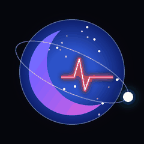
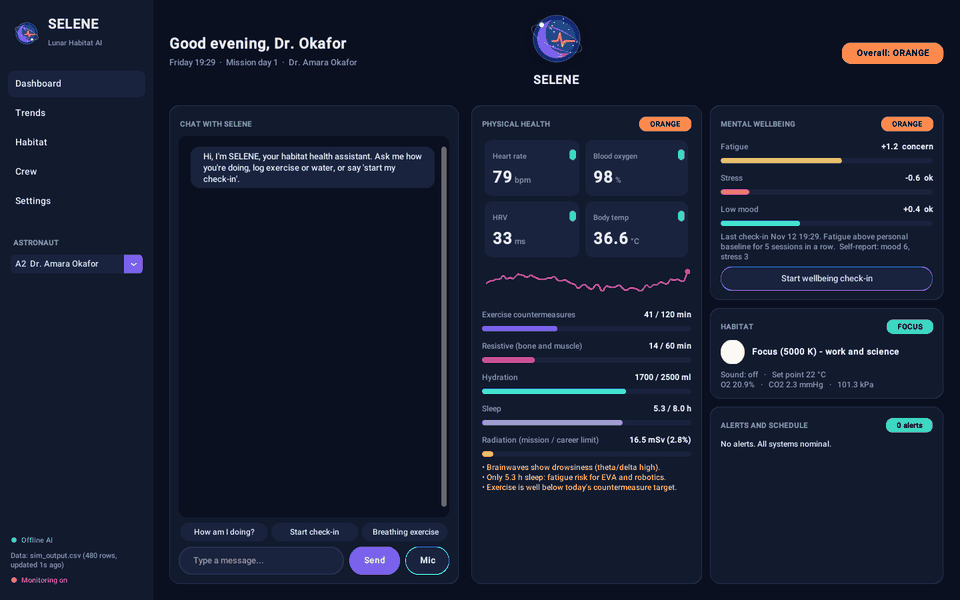
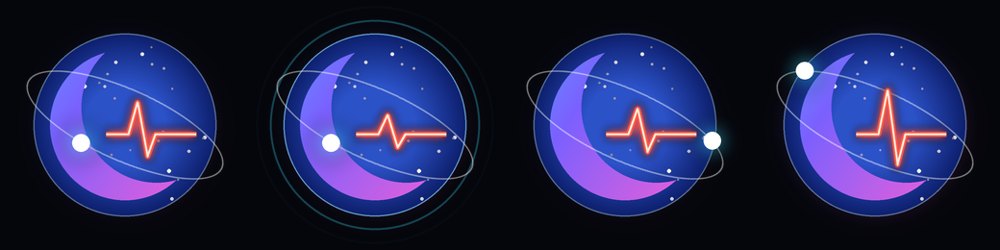
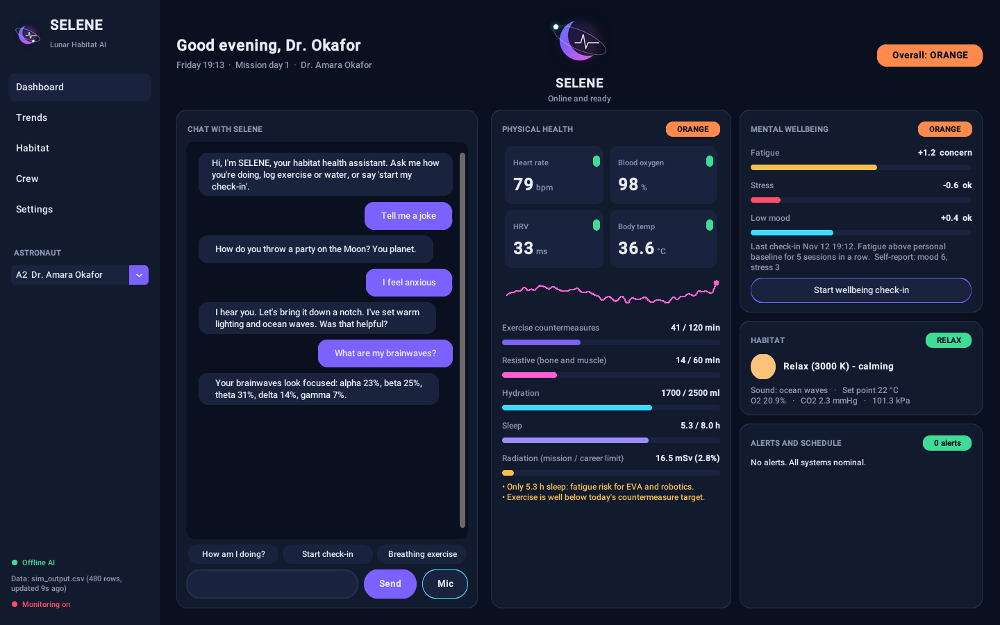
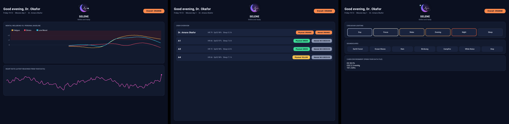
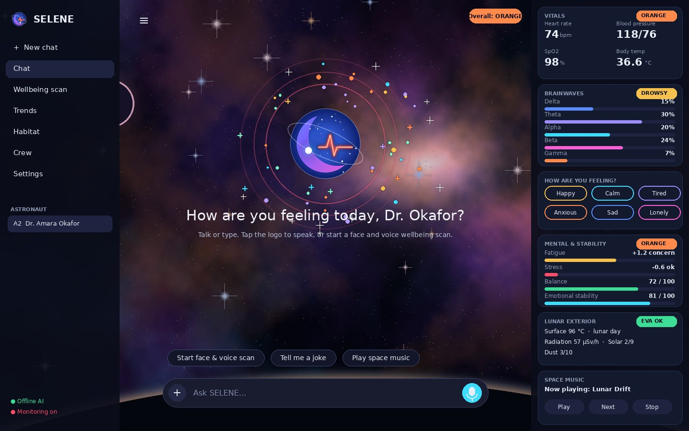
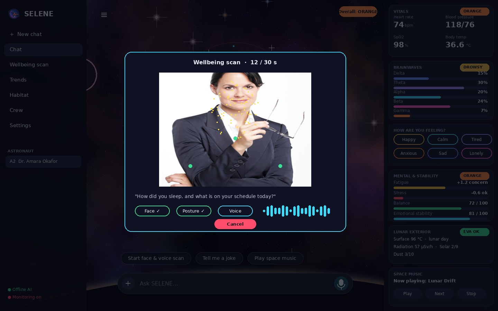

<div align="center">



# SELENE: Lunar Habitat AI

**S**pace **E**nvironment **L**ife & **N**euro-health **E**ngine: an AI health companion for astronauts on the Moon.


</div>

---

## 🚀 Quick start

1. Download: green **Code** button → **Download ZIP**, then unzip.
2. Open it:
   - **Windows:** double-click **`Start SELENE (Windows).bat`**
   - **Mac:** double-click **`start_selene.command`** (the first time: right-click → Open)
   - **Linux:** `./start_selene.command`

The first start checks for Python (and opens the download page if it's missing), installs
everything into a private `.venv` folder, and opens SELENE. Later starts open straight away.
Put your simulation's output file in **`data/`** and it's used automatically.

> Research and education prototype. It is not a medical device and never diagnoses.

## 🎬 See it in action

<div align="center">

<br/><sub>Real recording of the app: health summary, a joke, "I feel anxious" (lighting and ocean sounds change), and a brainwave reading.</sub>
</div>

## 🌙 The SELENE logo

<div align="center">

<br/><sub>Idle · Listening · Thinking · Speaking. A crescent Moon (the mission), an orbiting spark (the AI) and a heartbeat (health), drawn entirely in Python.</sub>
</div>

## 🖥️ Screenshots

| Dashboard | Trends · Crew · Habitat |
|---|---|
|  |  |

## 🌌 Coming next: the space interface (design concept)

These are **design mockups** of the next version, not screenshots yet: a full-screen nebula,
health particles and heartbeat rings around the logo, and a face-and-voice scan inside the app.

| Space home | Face and voice wellbeing scan |
|---|---|
|  |  |

<sub>The nebula backdrop is generated procedurally by <code>crew_monitor/space_art.py</code>. No copyrighted images are used.</sub>

## ✨ Features

| | Feature | What it does |
|---|---|---|
| 🤖 | **AI assistant** | Offline brain (works with no internet), or Claude when `ANTHROPIC_API_KEY` is set. Both use the same habitat and health tools |
| 🎙️ | **Voice chat** | Mic button, "Hey Selene" wake word, spoken replies |
| 🙂 | **Face, voice and posture scan** | 30-second check-in: blinks, drowsiness, smiles, frowns, pitch, pauses, slouching and fidgeting, compared with each astronaut's own baseline |
| ❤️ | **Physical health** | Heart rate, HRV, SpO₂, body temperature, blood pressure, blood flow, sleep, exercise countermeasures, hydration, radiation dose |
| 🧠 | **Brainwaves** | Delta, theta, alpha, beta and gamma shares, read as drowsy, relaxed, focused or high alert |
| 🎭 | **6 moods** | Happy, calm, tired, anxious, sad, lonely. SELENE answers with what it has *learned* works for you |
| 📈 | **Self-learning** | Helpful / not-helpful ratings and mood changes train a bandit model per astronaut |
| ⚖️ | **Stability** | Physical balance score and emotional stability from recent moods |
| 🌑 | **Lunar exterior** | Surface temperature, radiation, solar activity, dust, day/night, EVA advice |
| 💡 | **Smart habitat** | Circadian lighting (6500 K to 1900 K), temperature, cabin O₂/CO₂/pressure, alerts, schedule |
| 🎵 | **Space music** | Original tracks synthesized in Python (Lunar Drift, Earthrise, Solar Wind, Deep Field) plus soundscapes. Add your own WAVs to `music/` |
| 😄 | **Jokes and feedback** | Space humor, feedback after every action, nudges when vitals change |
| 🔒 | **Privacy** | Video and audio are never stored, with a pause button, consent for ground sharing, and delete-my-data |

## 🛠️ Run it manually

Python 3.10-3.12 is recommended. On Linux you also need `sudo apt install python3-tk libportaudio2 espeak`.

```bash
pip install -r requirements.txt
python -m crew_monitor setup-models
python -m crew_monitor dashboard --data path/to/your_simulation_output.csv
```

`setup-models` downloads the face and pose models once (about 10 MB). You can also open
the dashboard without `--data` and pick the file under **Settings**.

## 🧭 What's on the dashboard

| Area | Contents |
|---|---|
| **AI assistant** | Animated SELENE logo (idle, listening, thinking, speaking), chat, quick-prompt buttons, **Talk** push-to-talk, **Hey Selene** hands-free wake word, spoken replies |
| **Physical health** | Heart rate (with live trace), blood oxygen, HRV, body temperature; exercise countermeasures (120 min/day), resistive exercise for bone and muscle (60 min), hydration (2.5 L), sleep (8 h), radiation dose against NASA's 600 mSv career limit |
| **Mental wellbeing** | Fatigue, stress and low mood scored against the astronaut's own baseline, from the 30-second camera and microphone check-in (face, voice, posture) |
| **Habitat** | Circadian lighting (Day 6500 K to Night 1900 K), soundscapes, temperature, cabin O2, CO2 and pressure |
| **Alerts and schedule** | RED/ORANGE/YELLOW alerts, scheduled family calls |
| **Trends / Crew / Settings** | Mental trend chart and heart-rate history; whole-crew status; data file, voice and privacy controls |

## 🗣️ Voice commands

The wake phrase is "Hey Selene", or press **Talk**.

| Say | SELENE does |
|---|---|
| "How am I doing today?" | Physical and mental summary |
| "Start my check-in" | 30-second face, voice and posture wellbeing check |
| "Log 45 minutes of resistive exercise" / "I drank 500 ml" / "I slept 6 hours" | Adds to today's log, on top of your data file |
| "I feel stressed / tired / lonely" / "I can't sleep" | Supportive reply, plus lighting and sound changes or a family call |
| "Start a breathing exercise" | Guided 4-7-8 breathing |
| "Set lights to relax / night / focus / day" | Changes the lighting |
| "Play ocean waves" / "Stop sounds" | Soundscapes |
| "Set temperature to 23 degrees" | Cabin temperature |
| "What's my radiation dose?" / "Crew status" / "Habitat status" | Reports |
| "Schedule a family call" | Adds it to the schedule |
| "Medical emergency" / any mention of self-harm | **Immediate RED alert** to the commander and flight surgeon or psychologist (always offline, never waits for the network) |
| "I feel happy / calm / tired / anxious / sad / lonely" | Logs the mood and runs the response it has learned works best |
| "Tell me a joke" | Space humor |
| "Play space music" / "Next track" / "Stop music" | Original space music |
| "What are my brainwaves?" / "Blood pressure" / "How stable am I?" | Body readings |
| "Outside conditions" | Lunar surface and EVA advice |
| "What have you learned?" | Shows which responses work for you |
| "Pause monitoring" / "Resume monitoring" | Privacy |

## 🤖 AI modes

- **Offline AI** is the default. It understands the commands above with no internet, as a
  real lunar habitat would need with a 1.3-second, sometimes-down link to Earth.
- **Claude AI** turns on when `ANTHROPIC_API_KEY` is set. It gives natural conversation, and
  Claude calls the same habitat and health tools. If the link fails, SELENE falls back to
  offline mode automatically. Change the model with `SELENE_MODEL`.

Speech-to-text uses Google's free recognizer, which needs internet. For fully offline
speech, `pip install vosk`, download a Vosk model, and set `SELENE_STT=vosk`. Spoken replies
(pyttsx3) are always offline.

## 🔌 Connecting your simulation

Your simulation writes a **CSV, JSON or JSON-lines** file with one row per reading. The
dashboard re-reads it whenever it changes. Only `astronaut_id` is required. Column names are
matched case-insensitively, and common alternatives are accepted (`hr`, `pulse`, `crew`,
`sleep_hours`, `co2`...; the full list is in `crew_monitor/datasource.py` → `ALIASES`).
Unrecognised columns are listed under Settings so you can map them.

| Column | Meaning |
|---|---|
| `timestamp`, `astronaut_id`, `mission_day` | When, who, which mission day |
| `heart_rate`, `hrv_ms`, `spo2`, `skin_temp_c`, `resp_rate` | Wearable vitals |
| `sleep_h`, `exercise_min`, `resistive_min`, `water_ml`, `steps` | Daily totals so far |
| `radiation_msv`, `radiation_today_msv` | Mission dose and today's dose |
| `mood`, `stress`, `sentiment` | Self-report / NLP scores (shown and used in check-ins) |
| `eeg_delta`, `eeg_theta`, `eeg_alpha`, `eeg_beta`, `eeg_gamma` | Brainwave band power (EEG headband) |
| `systolic_bp`, `diastolic_bp`, `perfusion_index` | Blood pressure and blood flow |
| `balance_score` | Postural stability, 0-100 |
| `ext_temp_c`, `ext_radiation_usv_h`, `solar_activity`, `dust_level`, `sun_elevation_deg` | Lunar exterior |
| `o2_pct`, `ppco2_mmhg`, `pressure_kpa`, `cabin_temp_c`, `humidity_pct` | Cabin air |

See `examples/data_format_example.csv` for the layout.

## 🙂 Wellbeing check-in (face, voice, posture)

The check-in records 30 seconds of camera and microphone. MediaPipe face blendshapes give
blinks, drowsiness (PERCLOS), smiling, frowning and gaze; MediaPipe pose gives head drop,
slouching, movement and fidgeting; voice prosody gives pitch, monotone range, pauses and
speech rate. The first 5 check-ins learn each astronaut's own baseline. After that, fatigue,
stress and low mood are scored as robust z-scores against that baseline, with trend and
"says fine, but behaviour differs" flags.

## 🔒 Privacy

Video and audio are processed in memory and never saved; only numbers are stored, in a
local SQLite file. There is a visible monitoring light and a pause command. Ground sees
results only with consent (`python -m crew_monitor consent A1 on`), and
`python -m crew_monitor forget A1` deletes a person's data.

## ⌨️ Command line

| Command | Purpose |
|---|---|
| `dashboard --data FILE` | Open the AI dashboard |
| `enroll A1 --name "Name" --role Engineer` | Register an astronaut and their display name |
| `checkin A1` / `analyze A1 --video v.mp4 --audio a.wav` | Check-in without the dashboard |
| `report [A1] [--html out.html]` | Text or HTML report |
| `consent A1 on/off`, `pause`, `resume`, `forget A1` | Privacy |

## 🧪 Tests

```bash
python -m unittest discover tests
```

## 📁 Project files

| File | Purpose |
|---|---|
| `crew_monitor/gui.py` | Dashboard window (CustomTkinter) |
| `crew_monitor/assistant.py` | SELENE: tools, offline brain, Claude brain, safety rules |
| `crew_monitor/voice_io.py` | Microphone → text, text → speech, wake word |
| `crew_monitor/logo.py` | The SELENE logo, drawn in code |
| `crew_monitor/datasource.py` | Reads your simulation output |
| `crew_monitor/physical.py` | Physical health targets and flags |
| `crew_monitor/habitat.py` | Lighting, sound, temperature, exterior, alerts, schedule |
| `crew_monitor/music.py` | Space music and soundscape synthesizer |
| `crew_monitor/learning.py` | Per-astronaut learning (Thompson-sampling bandit) |
| `crew_monitor/space_art.py` | Procedural nebula backdrop |
| `crew_monitor/face.py`, `posture.py`, `voice.py`, `fusion.py` | Wellbeing check-in analysis |
| `crew_monitor/context.py`, `store.py`, `capture.py`, `cli.py`, `report.py` | App state, database, camera, CLI, reports |

---

<div align="center"><sub>Built for the NASA HUNCH program. NASA's name is used only to identify the program; this project is not endorsed by NASA.</sub></div>
